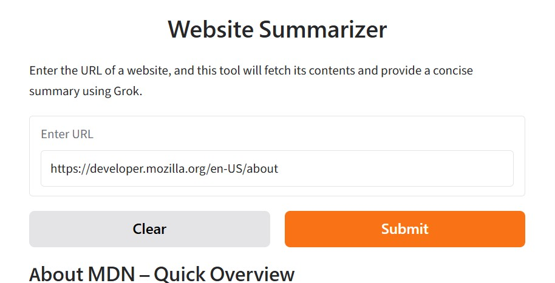

# Website Summarizer

A small web app that fetches a website, extracts its readable text, and uses a Groq-hosted language model to return a concise Markdown summary.

## Screenshot



## Features

- Accepts a website URL in a simple Gradio interface.
- Fetches the page and removes common navigation and layout elements.
- Summarizes the extracted text with Groq's OpenAI-compatible API.
- Displays the summary as Markdown.

## Requirements

- Python 3.10 or newer
- A Groq API key

## Setup

1. Clone this repository and open its folder:

   ```bash
   git clone <your-repository-url>
   cd <repository-folder>
   ```

2. Create and activate a virtual environment:

   **Windows (PowerShell):**

   ```powershell
   python -m venv .venv
   .\.venv\Scripts\Activate.ps1
   ```

   **macOS / Linux:**

   ```bash
   python -m venv .venv
   source .venv/bin/activate
   ```

3. Install the dependencies:

   ```bash
   python -m pip install -r requirements.txt
   ```

4. Copy `.env.example` to `.env` and add your Groq API key:

   ```dotenv
   GROQ_API_KEY=your_groq_api_key
   GROQ_API_BASE_URL=https://api.groq.com/openai/v1
   ```

   Keep `.env` private; it is excluded from Git.

5. Start the app:

   ```bash
   python app.py
   ```

   Open the local URL printed by Gradio in your browser.

> **Sharing note:** The app currently launches Gradio with `share=True`, which also creates a public share URL. Set it to `False` in `app.py` if you only want local access.

## How it works

1. `app.py` provides the Gradio interface.
2. `scraper.py` fetches the submitted URL and extracts page text.
3. `summarizer.py` sends the text to Groq and returns a concise summary.

## Configuration

The app reads these settings from `.env`:

| Variable | Description |
| --- | --- |
| `GROQ_API_KEY` | API key for your Groq account |
| `GROQ_API_BASE_URL` | OpenAI-compatible Groq API endpoint |

## Notes

- Some websites may block automated requests or require JavaScript, so their content might not be available to the scraper.
- Avoid submitting private URLs or sensitive page content to a third-party AI provider.
